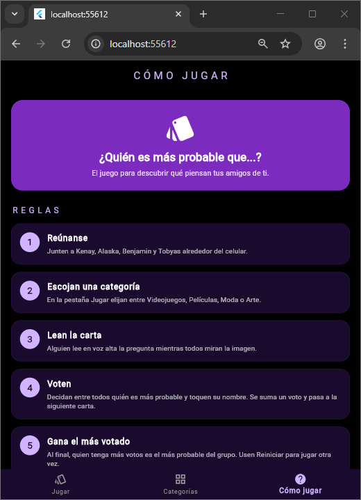

# Probabilidad

Aplicación móvil del juego "¿Quién es más probable que...?" desarrollada en Flutter y Dart.

## Descripción

Probabilidad es un juego para grupos de amigos. En cada carta aparece una pregunta con una imagen, el grupo decide quién es más probable que lo haga y vota tocando el nombre de esa persona.

La app tiene tres secciones conectadas con una barra de navegación inferior:

- **Jugar:** selector de categorías, carta con pregunta e imagen, botones de los jugadores con su número de votos, indicador de carta, quién va ganando, saltar carta y reiniciar.
- **Categorías:** tarjetas de Videojuegos, Películas, Moda y Arte con imagen y descripción.
- **Cómo jugar:** reglas del juego paso a paso.

Jugadores: Kenay, Alaska, Benjamin y Tobyas.

## Estructura del proyecto

```
lib/
├── main.dart
├── screens/
│   ├── categorias_screen.dart
│   ├── como_jugar_screen.dart
│   └── jugar_screen.dart
└── widgets/
    ├── carta_pregunta.dart
    ├── categoria_card.dart
    └── regla_item.dart
```

## Cómo ejecutarlo

1. Tener instalado Flutter y un emulador, dispositivo o Chrome.
2. Clonar el repositorio.
3. Abrir la carpeta del proyecto en la terminal y ejecutar:

```
flutter pub get
flutter run
```

## Capturas

### Jugar


### Categorías


### Cómo jugar


## Video de funcionamiento

https://drive.google.com/file/d/1kWjbNp2ZBS96141aQpIIA-qtAIoXal4b/view?usp=sharing

## Autora

Hanna Gabriela Castaño Beltran